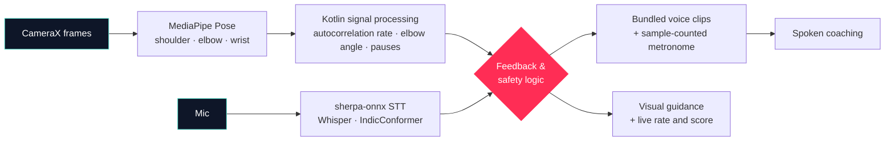

 

-5eead4?style=flat-square&labelColor=0e1628)

### *A CPR instructor that watches you, coaches you out loud, and speaks your language, with no internet needed.*

> [!IMPORTANT]
> **CPR Coach is a student hackathon prototype, not a medical device.** In a real emergency, **call 112** (or **108** for an ambulance in India), follow the dispatcher, and **start CPR right away**. Never delay care to set up a phone or wait for the app.

## The problem

Someone collapses at a railway station. A crowd gathers. Someone calls an ambulance.

**And nobody knows how to do CPR properly.**

Maybe someone watched a YouTube video once, or did a workshop years ago. Under stress, that memory goes. Most CPR apps don't help much either: they play a video or a metronome, but they can't tell whether you're doing it right. Most of them are also English-only, which leaves out a lot of India.

Hands-on training with feedback manikins works, but it needs instructors and expensive equipment that most colleges and communities don't have.

## The idea

**CPR Coach turns an ordinary smartphone into a CPR instructor.**

The camera watches the rescuer's arms. The app works out how fast they're compressing, whether their elbows are locked, and whether they've stopped. Then it **tells them out loud**, in their own language:

**"Push faster."**&nbsp;&nbsp;·&nbsp;&nbsp;**"Keep your arms straight."**&nbsp;&nbsp;·&nbsp;&nbsp;**"Keep going."**

 

<i>Concept illustration. The numbers shown are examples, not measured results.</i>

## How it works

| | Step | What happens |
|:-:|---|---|
| **1** | **Point the camera** | Prop the phone up to see the rescuer's upper body from the side. |
| **2** | **Track the arms** | MediaPipe follows the shoulder, elbow and wrist landmarks in real time, on the device. |
| **3** | **Read the rhythm** | Signal processing turns the up-and-down wrist motion into a compression rate, works out the elbow angle, and spots pauses. |
| **4** | **Coach out loud** | Short spoken prompts from voice clips bundled in the app, so the rescuer never needs to look at the screen. |
| **5** | **Talk back** | On-device speech recognition handles simple voice commands, so you can use it hands-free. |

## Two modes, one app

<table>
<tr>
<td width="50%" valign="top">

### Training mode
**The main feature, and what we demo.**

Practise on a CPR manikin and get live feedback and a score at the end:

- Compression-rate consistency (target **100–120/min**)
- Elbow posture
- Pauses and interruptions
- Tracking quality, so you know how far to trust the score

Built for colleges, NSS units and community groups that can't afford feedback manikins.

</td>
<td width="50%" valign="top">

### Emergency guidance
**Experimental. Safety first.**

- A big button that starts with **call 112 / 108**
- Clear CPR steps in your language
- A metronome you can hear at 110/min
- Optional camera coaching, only if it doesn't slow you down
- Still works if the camera, voice models or network fail

This needs proper clinical and usability testing before anyone should rely on it.

</td>
</tr>
</table>

## Speaks your language

CPR instructions are only useful if you understand them while panicking.

CPR Coach uses **offline speech models**: recognition runs on the device, and the spoken coaching is generated ahead of time and shipped as clips. Clips cover **10 languages**; recognition covers a language once its model is installed on the phone. Everything runs locally, so there's no cloud API, no data leaving the phone, and no dead zones where it stops working.

> The final language list, model sizes and supported devices will be published after full integration testing. Every emergency instruction stays usable **without** voice.

## Architecture

### Stack

| Layer | Tech |
|---|---|
| App | Native Android, Kotlin, Jetpack Compose (Material 3); `minSdk` 30, `arm64-v8a` |
| Camera | CameraX on the `camera2` backend; frames arrive as `ImageProxy` |
| Pose estimation | MediaPipe Tasks Vision Pose Landmarker in `LIVE_STREAM` mode, GPU delegate with CPU fallback, model bundled in the APK |
| Motion analysis | Kotlin on-device signal processing: torso-normalised wrist signal → 30 Hz resampling → drift removal → normalised **autocorrelation** with parabolic peak refinement; elbow angle from shoulder–elbow–wrist geometry; pauses from the absence of a steady beat |
| Coaching logic | Deterministic Kotlin policy: a correction must hold steady, then a cooldown, and never the same phrase twice in a row |
| Speech in | sherpa-onnx offline recognisers: Whisper `tiny.en` for English, IndicConformer for the nine Indic languages, Silero VAD for hands-free listening |
| Speech out | Pre-recorded voice clips per language, generated ahead of time with sherpa-onnx TTS, mixed with a sample-counted metronome on one streaming `AudioTrack` — no live synthesis |
| State and storage | Kotlin coroutines and `StateFlow`; `SharedPreferences` for the chosen language |
| Offline | Models and clips ship with the app; no `INTERNET` permission and no networking code |
| Tests and tooling | JUnit4 JVM unit tests over synthetic rate traces; a Python/numpy trace analyser for recordings pulled off a phone |

> Needs Android 11+ on an `arm64-v8a` phone. Pose uses the GPU delegate where the device supports it and falls back to CPU; recognition models load per language, so the first transcription after a language switch takes longer.

## What it can and can't measure

We'd rather be honest than impressive

| What it estimates | What it can't measure |
|---|---|
| **Compression rate**, from repeated visible motion | **Compression depth** in cm (one camera can't do this reliably) |
| **Elbow angle**, from shoulder–elbow–wrist geometry | Compression **force** or full **chest recoil** |
| **Pauses**, as gaps in detected motion | Exact **hand placement** |
| **Tracking quality**, so you know how far to trust it | Whether CPR is **clinically effective** |

Bad lighting, odd camera angles, people blocking the view or a slow phone can all throw the estimates off. Speech recognition can fail in a noisy crowd. That's why nothing critical depends on it.

## Prior art (and where we fit)

**Camera-based CPR feedback isn't new, and we know that.** Our competitor review found similar efforts in India, including **HaloCPR**, **eCPR** and **ReRhythm**, as well as hardware-based systems that pair an app with sensor manikins.

What we're betting on is a combination that's still uncommon:

**Low-cost visual feedback** &nbsp;+&nbsp; **Multilingual on-device voice** &nbsp;+&nbsp; **Fully offline** &nbsp;+&nbsp; **Training and emergency in one app**

We're offering this as a product direction to test, not as a claim of novelty.

## Where it stands

Built in 24 hours at Anvathon 2026, where it **won first place**. Practised on a cushion or training manikin, never used on a real patient.

**Built and working in the demo build**
- [x] Practise mode: framing guide, countdown, live camera coaching, pause and resume, two-minute session and scorecard
- [x] On-device pose tracking with compression rate, elbow angle and pause detection
- [x] Spoken coaching from bundled voice clips, with a metronome that keeps playing when tracking drops
- [x] Emergency mode that starts with calling 112, step-by-step guidance and a 110/min metronome
- [x] Offline speech recognition for simple voice commands
- [x] The team tried Hindi, Kannada, English and Gujarati on a phone and they worked well

**Not done yet**
- [ ] Counted accuracy runs: app rate against a hand-counted, timed video ([how we'll run them](docs/ACCURACY_TEST.md))
- [ ] Review of the other six languages (Tamil, Telugu, Malayalam, Marathi, Bengali, Odia) by native speakers
- [ ] Feedback from qualified CPR trainers
- [ ] Accelerometer fallback for when the camera can't see

Everything tested so far is an **informal prototype test**, not clinical validation.

## Build and run

You need Android Studio (or the Android SDK and a JDK), an **Android 11+ `arm64-v8a` phone** and a USB cable.

1. Clone this repo and, next to it, [iTantra](https://github.com/VivekTiwary-25/Itantra). CPR Coach reuses iTantra's offline speech models.
2. Restore the speech models with iTantra's `setup-models.ps1` (see its README).
3. Copy the English recogniser into this app: `.\tools\push-models.ps1 -CopyWhisper`
4. Build and install: `.\gradlew.bat assembleDebug`, then `adb install -r app\build\outputs\apk\debug\app-debug.apk`
5. Push the Indic speech models to the phone: `.\tools\push-models.ps1`

Full steps, with checks at each stage: [`docs/INSTALL.md`](docs/INSTALL.md). How the pipeline works on one page: [`docs/HOW_IT_WORKS.md`](docs/HOW_IT_WORKS.md).

## Team

Built at Anvathon 2026 by four students of The National Institute of Engineering, Mysuru:

- [**Vivek Tiwary**](https://github.com/VivekTiwary-25): the voice layer (offline speech recognition) and the MLOps side of the build
- [**Pratham**](https://github.com/sadisticbrew)
- [**Prabal Pratap Singh**](https://github.com/prabal009)
- [**Moksh Srivastava**](https://github.com/moksh033)

## Disclaimer

This is a student hackathon project for education, prototype research and guided practice. It does **not** diagnose cardiac arrest, certify CPR skills, or replace emergency dispatchers, qualified instructors or official resuscitation guidelines. **Never delay emergency services or care to use this app.**

 

**Built in 24 hours for Anvathon 2026, and won it** · Open Innovation · Healthcare & Public Safety

The heart in the banner beats at 110 bpm, right in the CPR target zone.

